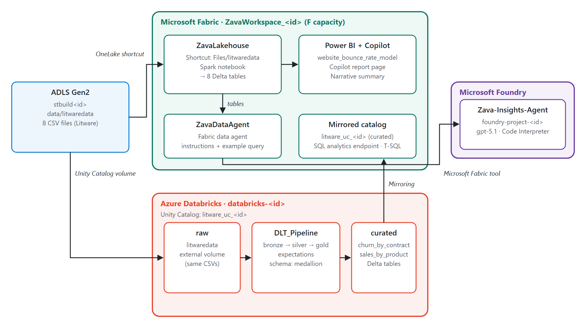

# Modernize your data estate with Microsoft Fabric, Azure Databricks, and Microsoft Foundry

### Overall Duration: 100 Minutes (Fabric-only version: 75 Minutes)

Hands-on lab for Microsoft AI Tour 2026 session **WRK560**, delivered on CloudLabs.

## 📘 Lab Scenario

Zava, a regional DIY retailer, is acquiring **Litware Inc.** Litware keeps its curated marketing, sales, and churn data in ADLS Gen2 and runs its analytics on Azure Databricks. Zava's new CEO wants to reverse falling sales, high churn, and a high website bounce rate. As Zava's data engineer, data analyst, and data scientist, you unify both companies' data in OneLake, find insights with Copilot for Power BI, and build AI agents that answer business questions in plain language.

## 🎯 Lab Objectives

- **Ingest data into OneLake:** Create a Fabric workspace and lakehouse, reference Litware's ADLS Gen2 data with a OneLake shortcut, and load it into Delta tables with a Spark notebook.
- **Analyze with Copilot for Power BI:** Build a semantic model, generate a report page with Copilot, and summarize it with the Narrative visual.
- **Build AI agents:** Create and tune a Fabric data agent, then ground a Microsoft Foundry agent with it and add Code Interpreter.
- **Curate and mirror Azure Databricks data:** Run a Delta Live Tables pipeline over Litware's Unity Catalog data and mirror the curated tables into Fabric.

## 🏗️ Architecture



## 📚 Lab Guide

| Page | What you do | Duration |
|---|---|---|
| [Getting Started](getting-started.md) | Scenario, architecture, your lab resources, sign in to Microsoft Fabric | 5 min |
| [Exercise 01](exercise-01.md) | Create a workspace and lakehouse, add an ADLS Gen2 shortcut, and load Delta tables with a notebook | 20 min |
| [Exercise 02](exercise-02.md) | Create a semantic model, generate a report and insights with Copilot for Power BI | 15 min |
| [Exercise 03](exercise-03.md) | Create, tune, and publish a Fabric data agent, then build a Foundry agent grounded with it | 30 min |
| [Exercise 04](exercise-04.md) | Build a Delta Live Tables pipeline in Azure Databricks and mirror the catalog into Fabric | 25 min |
| [Knowledge Check](knowledge-check.md) | Three questions, optional clean up, conclusion | 5 min |

The lab comes in two versions:

| Version | Master document | Parameter file | Pages |
|---|---|---|---|
| Full | [masterdoc.json](masterdoc.json) | [deploy-01.parameters.json](Deployment/deploy-01.parameters.json) | Getting Started, Exercises 01-04, Knowledge Check |
| Fabric-only | [masterdoc-fabric.json](masterdoc-fabric.json) | [deploy-01-fabric.parameters.json](Deployment/deploy-01-fabric.parameters.json) | [Getting Started (Fabric)](getting-started-fabric.md), Exercises 01-03, Knowledge Check |

## 🧰 Lab Environment

Each learner gets one resource group, deployed by [Deployment/deploy-01.json](Deployment/deploy-01.json):

| Resource | Name | Used in |
|---|---|---|
| Lab VM (Windows Server 2022) with Edge shortcuts for Fabric, the Azure portal, and Foundry | `labvm-<id>` | All exercises |
| Fabric capacity (F8), with the learner as capacity admin | `fabric<id>` | Exercises 01-04 |
| ADLS Gen2 storage account, seeded with the Litware data in `data/litwaredata` | `stbuild<id>` | Exercises 01 and 04 |
| Microsoft Foundry resource and project, with a `gpt-5.1` deployment | `foundry-<id>`, `foundry-project-<id>` | Exercise 03 |
| Azure Databricks workspace (Premium) and access connector, with Unity Catalog catalog `litware_uc_<id>` and the DLT notebook pre-created | `databricks-<id>`, `databricks-ac-<id>` | Exercise 04 (full version only) |

The lab data is in [Dataset/litwaredata.zip](Dataset/litwaredata.zip). See [Dataset/README.md](Dataset/README.md) for its contents.

## ⚙️ CloudLabs Template Settings

| Setting | Value |
|---|---|
| ARM Template URL | `https://raw.githubusercontent.com/Balunywa/wrk560-fabric-databricks-foundry/main/Deployment/deploy-01.json` |
| Parameter Template URL | `.../main/Deployment/deploy-01.parameters.json` (full) or `.../main/Deployment/deploy-01-fabric.parameters.json` (Fabric-only) |
| GitHub Master Document URL | `.../main/masterdoc.json` (full) or `.../main/masterdoc-fabric.json` (Fabric-only) |
| Region | East US 2 or Sweden Central |
| Enable VM Access Over Http | On. VM `labvm-{GET-DEPLOYMENT-ID}`, type RDP, from outputs `LabVM DNS Name`, `LabVM Admin Username`, `LabVM Admin Password` |
| Excluding Output Parameters | `TrainerUserName`, `TrainerUserPassword` |
| Template Permissions | Contributor on the resource group (attendee) |
| MS Cloud Licenses | Power BI Pro |
| Validations | Six steps, listed in [Validation/README.md](Validation/README.md) |

**Fabric tenant settings:** turn on Fabric item creation, Copilot and Azure OpenAI features, and data agents.

**Full version only:** a Databricks metastore admin must turn on **External data access** for the region's metastore, so Fabric can mirror the catalog.

## 📁 Repository Contents

```text
.
├── masterdoc.json / masterdoc-fabric.json   CloudLabs master documents
├── getting-started.md / getting-started-fabric.md
├── exercise-01.md ... exercise-04.md
├── knowledge-check.md
├── questions/                               Knowledge check and inline questions
├── Images/                                  Lab guide screenshots and architecture diagrams
├── Dataset/litwaredata.zip                  Lab data (8 CSV files)
├── Deployment/                              ARM template, parameters, VM setup, Databricks setup, DLT notebook
├── Validation/                              CloudLabs validation scripts
└── tools/build-standin-data.py              Rebuilds Dataset/litwaredata.zip
```

## 🙏 Credits

- Based on [microsoft/aitour26-WRK560](https://github.com/microsoft/aitour26-WRK560-modernize-your-data-estate-ms-fabric-azure-databricks-and-microsoft-foundry) by Someleze Diko and contributors. Its instructions and screenshots are licensed under CC BY 4.0, and its code under MIT.
- The dimension and fact tables come from AdventureWorksDW in [microsoft/sql-server-samples](https://github.com/microsoft/sql-server-samples) (MIT).
