# Exercise 03: Build AI Agents with Fabric Data Agents and Microsoft Foundry

### Estimated Duration: 30 Minutes

## 📘 Scenario

Reta, Zava's data scientist, wants business users to get answers from Zava's data by asking questions in plain language. She also wants those answers available inside AI applications that Zava builds on Microsoft Foundry.

## 📖 Overview

In this exercise, you act as Reta. You create a Fabric data agent over the lakehouse tables and improve its answers with agent instructions and an example query, and then publish it. Next, you connect the published data agent to your Microsoft Foundry project. Finally, you build a Foundry agent that uses the Fabric data agent as a knowledge source and Code Interpreter to chart the results.

## 🎯 Objectives

In this exercise, you will complete the following tasks:

- Task 1: Create, tune, and publish a Fabric data agent
- Task 2: Connect the Fabric data agent to Microsoft Foundry
- Task 3: Build a Foundry agent grounded with Fabric data

## Task 1: Create, tune, and publish a Fabric data agent

In this task, you create a data agent that answers questions over Zava's lakehouse tables, and then improve its answers.

1. In Microsoft Fabric, select the **<inject key="Fabric Workspace Name" enableCopy="false"/>** workspace in the left navigation pane, and then select **+ New item**.

    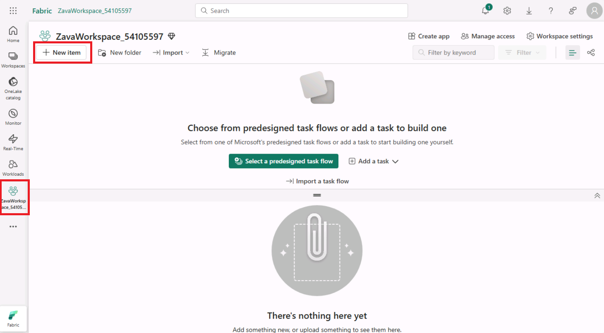

1. In the **New item** pane, search for **Data agent**, and then select **Data agent**.

    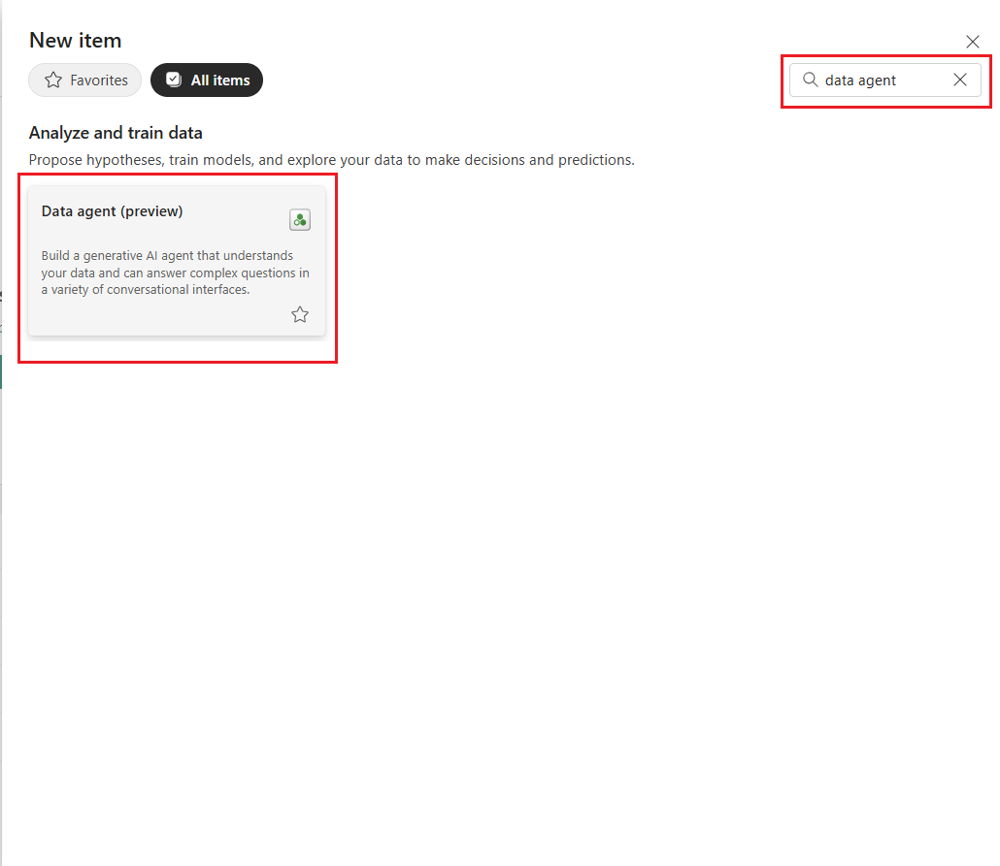

1. Enter the following name, and then select **Create**:

    - **Name:** `ZavaDataAgent`

1. When the data agent opens, select **Add a data source**.

    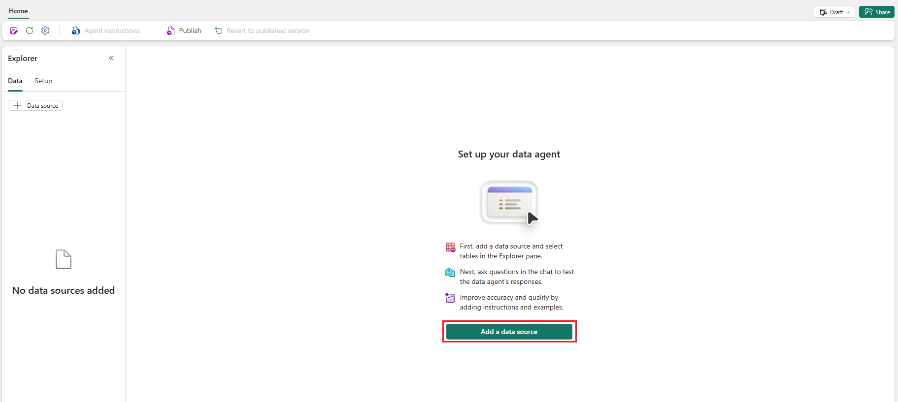

1. In the **Add a data source** pane, select **ZavaLakehouse**, and then select **Add**.

    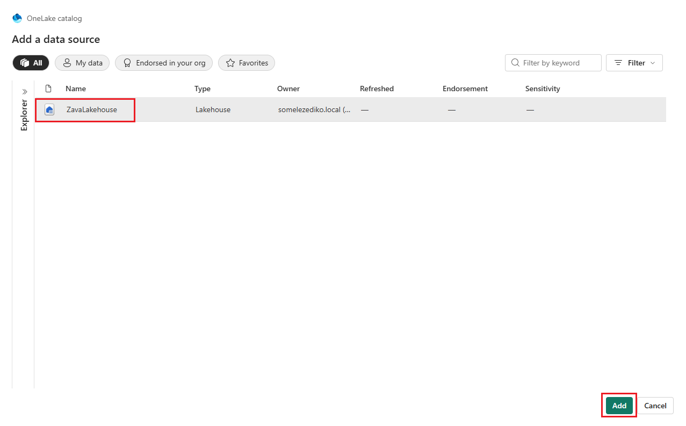

1. In the left pane, under **ZavaLakehouse**, expand **dbo** and select the following tables:

    - customerchurndata
    - dimcustomer
    - dimdate
    - dimproduct
    - dimreseller
    - factinternetsales
    - factresellersales

    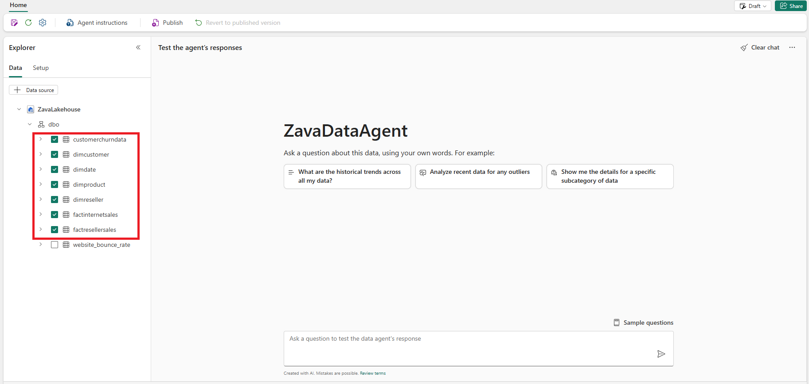

1. Help Zava find its most sold product. Enter the following question in the chat box, and then select **Send**:

    ```
    What is the most sold product?
    ```

    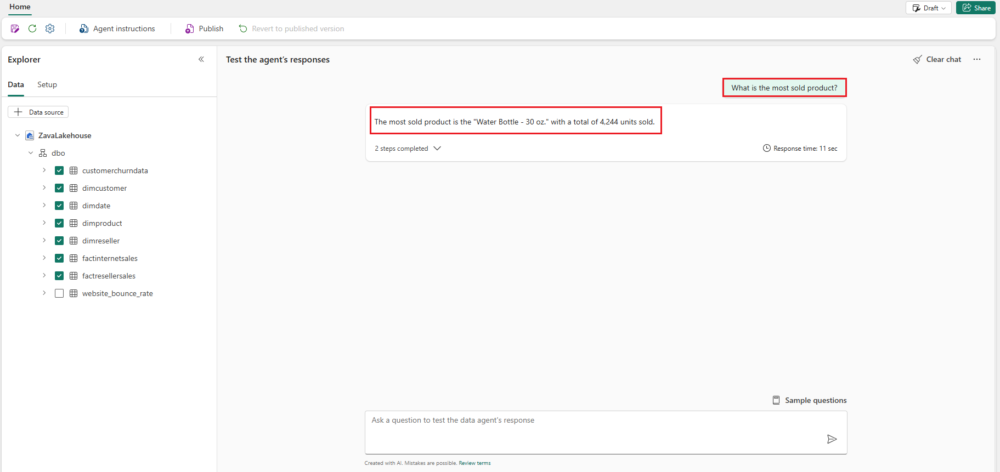

    Review the steps the agent took. The data agent shows its reasoning and the queries it generated.

1. The agent answered reasonably well, but its SQL query ranks products by order quantity (units sold) instead of by revenue. To fix this, select **Agent instructions** (on the **Setup** tab in the left pane), enter the following instructions, and then select **Close (X)**:

    ```
    Whenever I ask about "the most sold" products or items, the metric of interest is total sales revenue and not order quantity. The primary table to use is FactInternetSales. Only use FactResellerSales if explicitly asked about resales or when asked about total sales. Whenever I ask about "revenue from leaving" customers, the primary table to use is the customerchurndata and suggest one actionable retention strategy.
    ```

    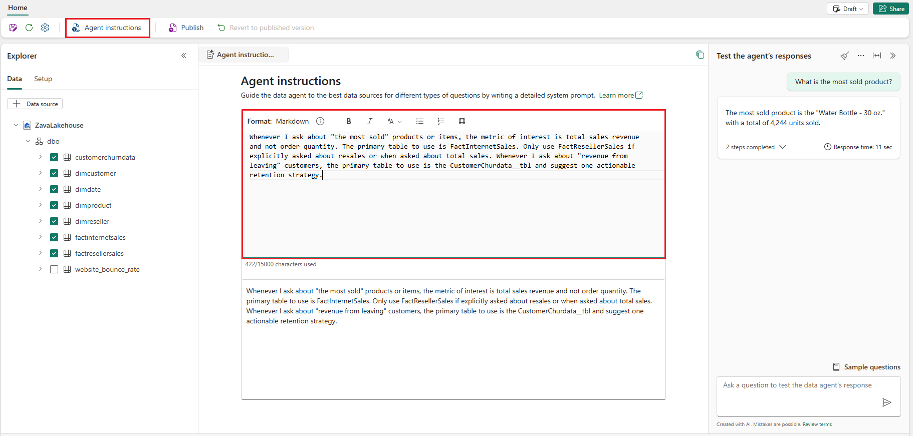

1. Ask the same question again and select **Send**:

    ```
    What is the most sold product?
    ```

    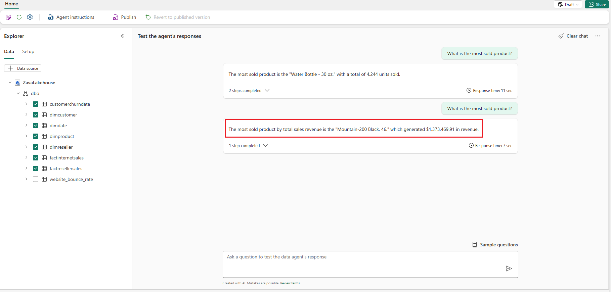

    This time the query ranks products by total sales revenue.

    > **Note:** If your results don't change, select **Clear chat** in the top-right corner to reset the conversation context, and then ask again.

1. You can also give the agent example queries. On the **Setup** tab, select **Example queries**.

    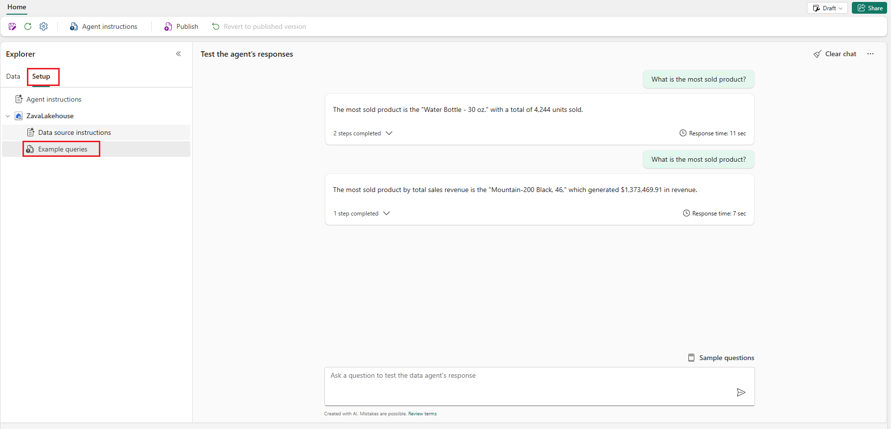

1. In the **Example queries for ZavaLakehouse** pane, select **+ Add**, and enter the following question and SQL query. Then select **Close (X)**.

    - **Question:**

        ```
        How much revenue are we losing from leaving customers vs those who are staying?
        ```

    - **SQL query:**

        ```sql
        SELECT StoreContract, Round(SUM(CASE WHEN Churn = 'Yes' THEN CAST(TotalAmount as FLOAT) * 12 ELSE 0 END), 2) AS ProjectedLostRevenue, Round(SUM(CASE WHEN Churn = 'No'  THEN CAST(TotalAmount as FLOAT) * 12 ELSE 0 END),2) AS ProjectedRetainedRevenue FROM customerchurndata GROUP BY StoreContract ORDER BY StoreContract;
        ```

    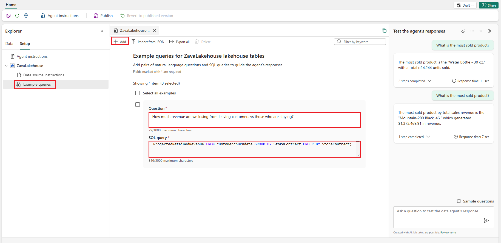

1. Ask the question in the chat box and select **Send**:

    ```
    How much revenue are we losing from leaving customers vs those who are staying?
    ```

    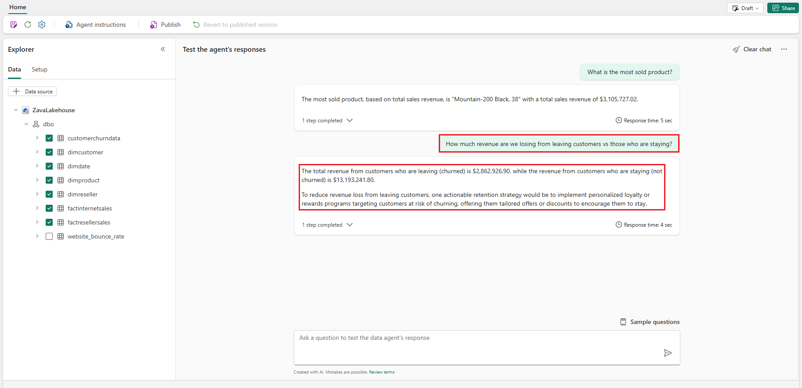

1. Select **Publish**. In the publish dialog, enter the following description, which helps other agents decide when to call this one, and then select **Publish**:

    ```
    The Zava Data Agent accesses business data from the Zava lakehouse, focusing on customer, sales, and time-related analytics.
    Key tables:

    - customerchurndata: Holds customer activity, transaction details, and churn information. Includes demographic, billing, support, and purchase data.
    - dimcustomer: Contains customer profiles—demographics, contact info, household, and occupation. Used to enrich transaction records with personal details.
    - dimdate: Provides calendar and fiscal details for each date. Supports time-based analysis across other tables.
    - dimproduct: Lists individual products with category and attribute details. Used to categorize sales and inventory data.
    - dimreseller: Contains reseller names, locations, and business types. Links reseller info to sales for channel performance analysis.
    - factinternetsales: Records internet sales transactions—amount, date, product, and customer involved. Core table for online sales analytics.
    - factresellersales: Tracks sales through resellers, with product, resale revenue, and date fields. Used to analyze channel and partner sales performance.

    Analyze revenue, churn, and retention by customer segment or contract.
    Identify top-selling products and sales trends.
    Profile customers for targeted actions and business improvements.
    ```

    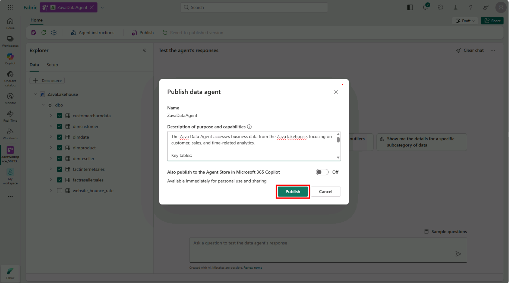

1. Copy the data agent's published URL from the browser address bar and paste it into Notepad on your virtual machine. You need two values from it in the next task:

    - **Workspace ID:** the value after `/workspaces/` in the URL
    - **Artifact ID:** the value after `/dataagents/` in the URL

    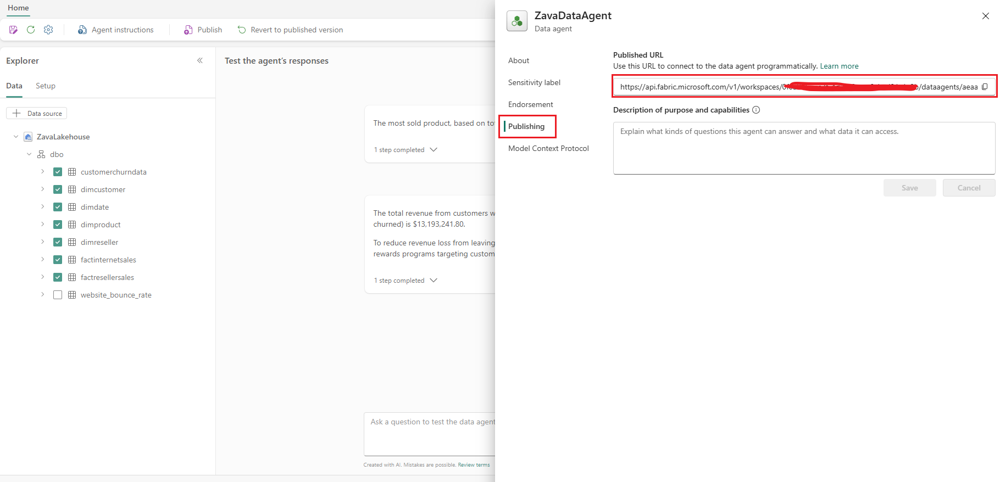

    > **Congratulations** on completing the task! Now, it's time to validate it. Here are the steps:
    > - Hit the Validate button for the corresponding task.
    > - If you receive a success message, you can proceed to the next task.
    > - If not, carefully read the error message and retry the step, following the instructions in the lab guide.
    > - If you need any assistance, please contact us at cloudlabs-support@spektrasystems.com. We are available 24/7 to help you out.

    <validation step="00000000-0000-0000-0000-0000000000a3" />

## Task 2: Connect the Fabric data agent to Microsoft Foundry

In this task, you add a connection to your published Fabric data agent in your Foundry project. Your project already has an Azure OpenAI model deployment, **<inject key="Model Deployment Name" enableCopy="false"/>**, which the Foundry agent will use as its base model.

1. In the Azure portal, open the **<inject key="Resource Group Name" enableCopy="false"/>** resource group.

    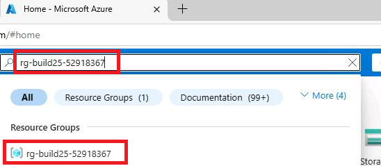

1. Select the **<inject key="Foundry Project Name" enableCopy="false"/>** Foundry project, and then select **Go to Foundry portal** to open the project in Microsoft Foundry.

    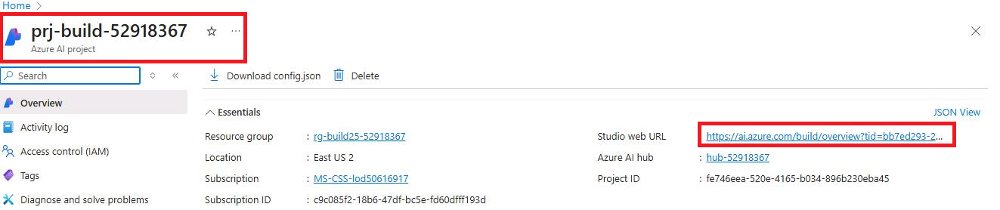

    > **Note:** Close any pop-ups that appear. If you're prompted to sign in, use the same credentials as in the Getting Started page.

1. In the left navigation pane, scroll down and select **Management center**.

    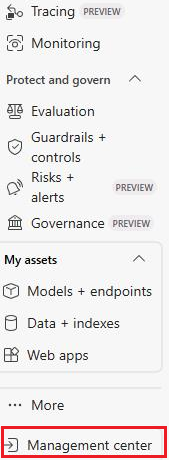

1. Under your project, select **Connected resources**, and then select **+ New connection**.

    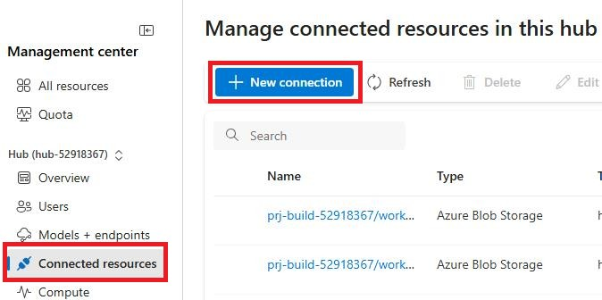

1. In the **Add a connection to external assets** dialog, under **Knowledge**, select **Microsoft Fabric**. Enter the following details:

    - **workspace-id:** Paste the **Workspace ID** you saved from the data agent URL.
    - **artifact-id:** Paste the **Artifact ID** you saved from the data agent URL.
    - **Connection name:** `ZavaDataAgent`

    Then select **Add connection**.

    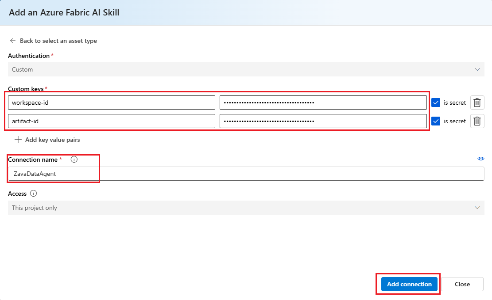

    > **Note:** If the connection doesn't work later, check that you didn't copy a trailing `/` with either ID. You can see the values you entered by clearing the **is secret** checkbox.

## Task 3: Build a Foundry agent grounded with Fabric data

In this task, you help Reta build a Foundry agent that uses the Fabric data agent to answer questions about Zava's customer and sales data.

1. In the **Management center**, select **Go to project** to return to your project.

    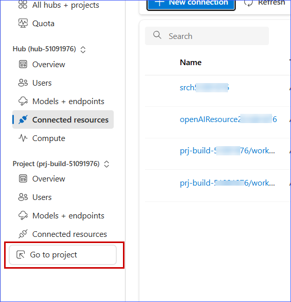

1. In the left navigation pane, select **Agents**, and then select **+ New agent**.

    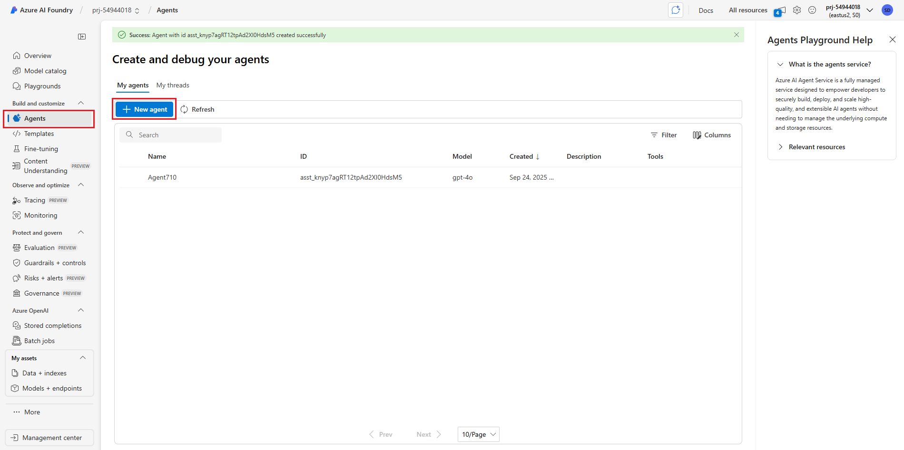

1. In the **Setup** pane on the right, enter the following details:

    - **Agent name:** `Zava-Insights-Agent`
    - **Deployment:** **<inject key="Model Deployment Name" enableCopy="false"/>**
    - **Instructions:**

        ```
        You are an AI assistant that helps Zava to gain insights from customer churn and sales data. Use the Fabric Data Agent to answer questions about customer behavior and sales trends. Provide clear and concise answers with relevant details.
        ```

    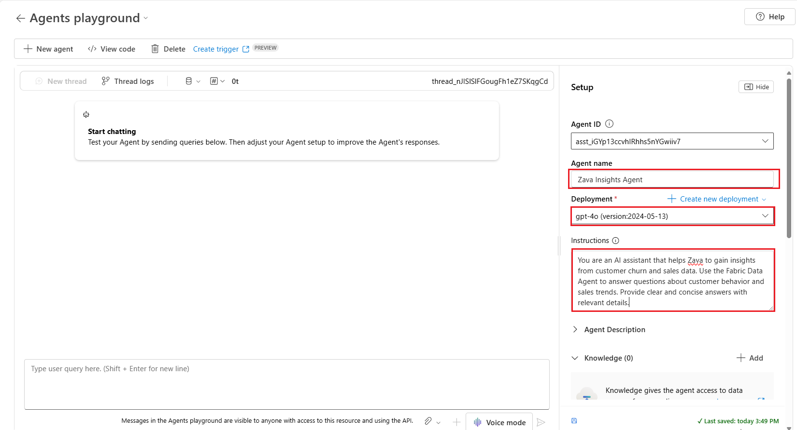

1. Next to **Knowledge (0)**, select **+ Add**.

    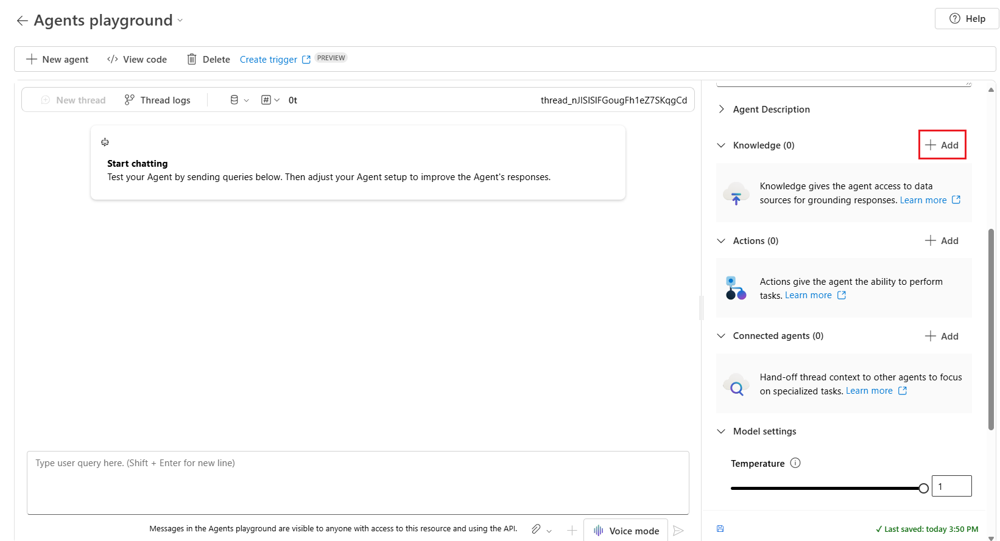

1. In the **Add knowledge** dialog, select **Microsoft Fabric**, select the **ZavaDataAgent** connection, and then select **Connect**.

    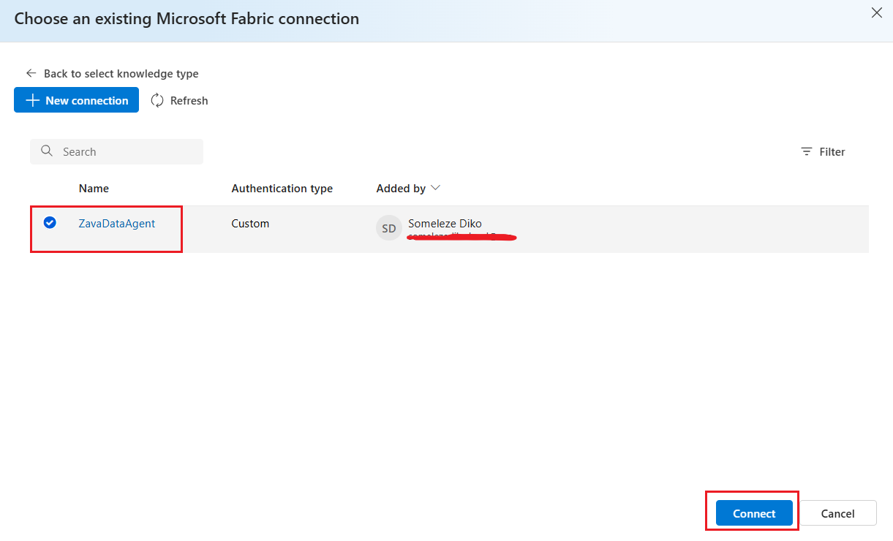

1. Confirm that **ZavaDataAgent** is listed under **Knowledge**.

    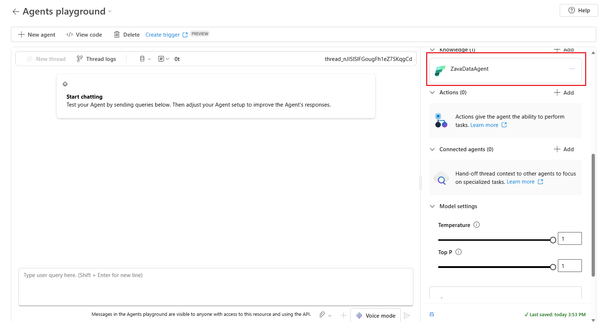

1. Next, let the agent run code. Next to **Actions (0)**, select **+ Add**.

    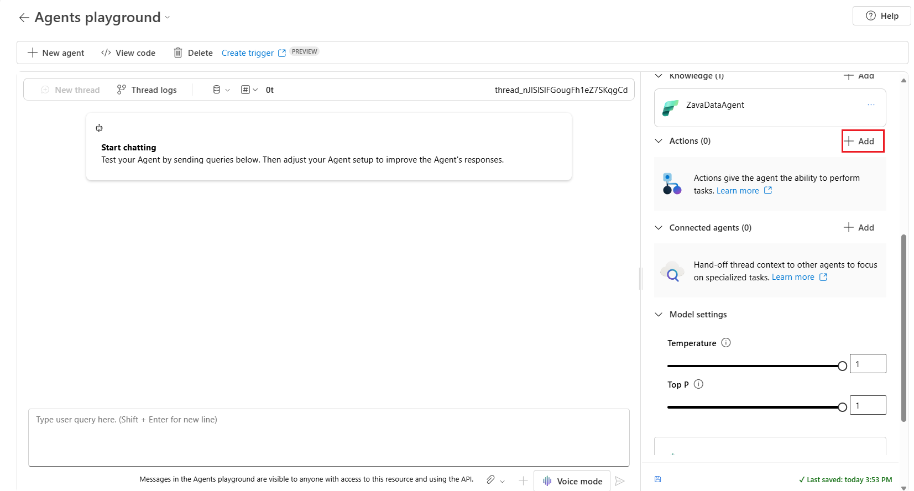

1. In the **Add action** dialog, select **Code interpreter**, and then select **Save**.

    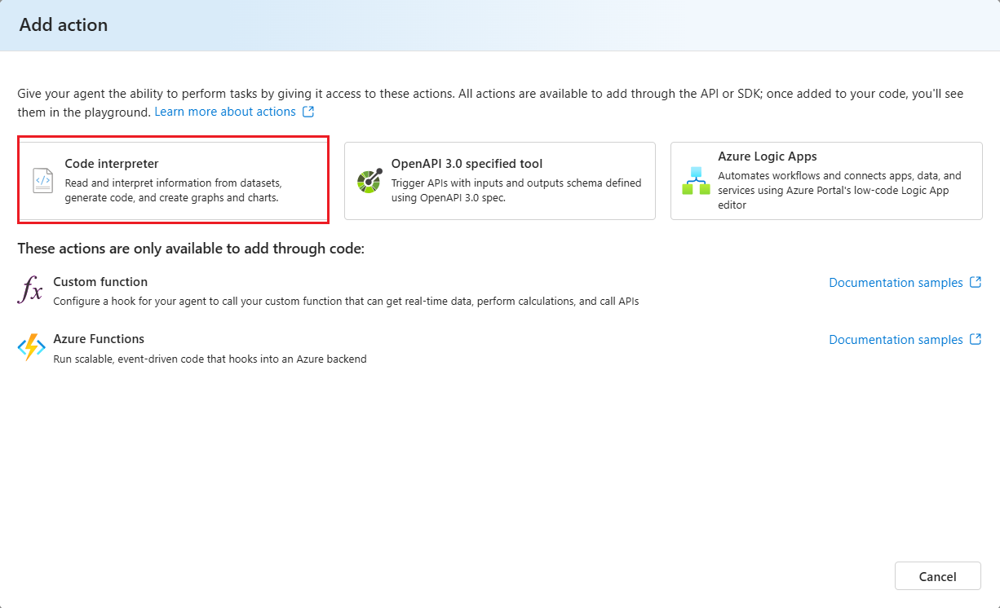

    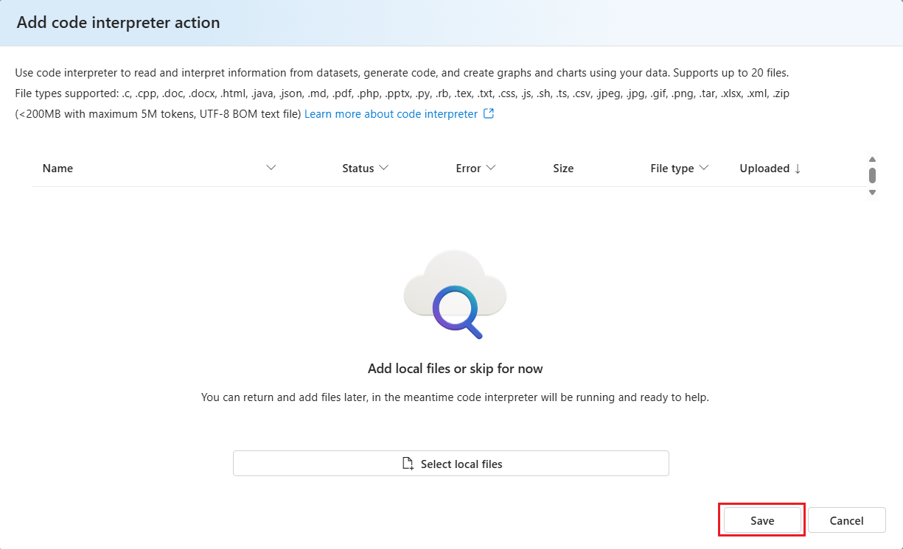

    > **Note:** You can also upload your own files for the code interpreter by using **Select local files**.

1. At the top of the **Setup** pane, select **Try in playground**.

    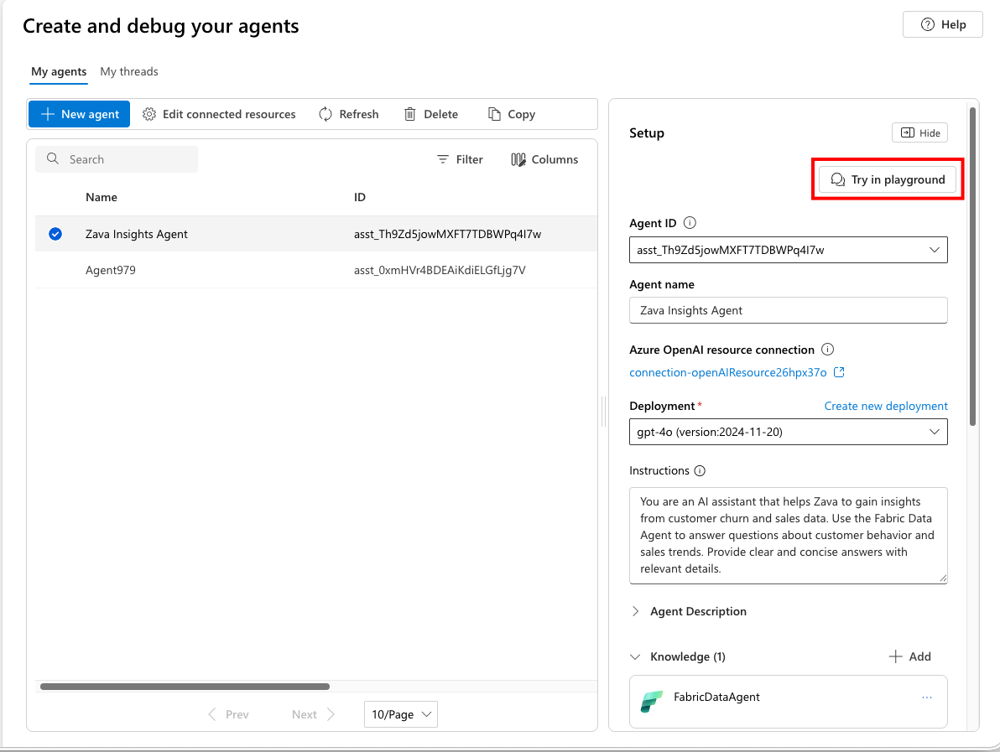

1. Enter the following question and select **Send**. The agent calls the Fabric data agent to get the data it needs.

    ```
    What are the top 5 selling products by total revenue?
    ```

    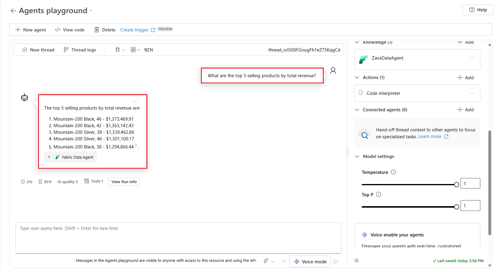

    > **Important:** The agent can take a few moments to respond while it queries the Fabric data agent. If you don't get the answer you expect, start a new thread and try again.

1. Help Reta visualize the results. Enter the following question and select **Send**. The agent uses Code Interpreter to draw a bar chart.

    ```
    Can you show me a bar chart of the top 5 selling products by total revenue?
    ```

    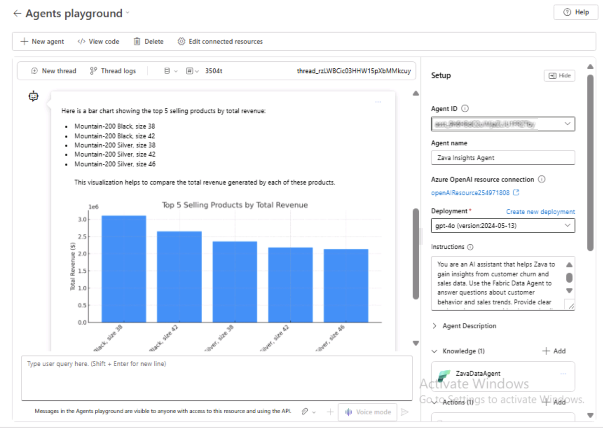

    > **Congratulations** on completing the task! Now, it's time to validate it. Here are the steps:
    > - Hit the Validate button for the corresponding task.
    > - If you receive a success message, you can proceed to the next task.
    > - If not, carefully read the error message and retry the step, following the instructions in the lab guide.
    > - If you need any assistance, please contact us at cloudlabs-support@spektrasystems.com. We are available 24/7 to help you out.

    <validation step="00000000-0000-0000-0000-0000000000a4" />

## 🧾 Summary

In this exercise, you created a Fabric data agent over Zava's lakehouse and improved its answers with instructions and an example query. You published it, connected it to Microsoft Foundry, and built a Foundry agent that uses it as a knowledge source and draws charts with Code Interpreter. Reta can extend the agent with more knowledge sources and tools, and deploy it to an app for Zava's team.

### Click on **Next** from the page navigation bar at the end of the lab guide page to proceed to the next page.

