# Exercise 04: Curate Litware's Data with Azure Databricks and Mirror It into Fabric

### Estimated Duration: 25 Minutes

## 📘 Scenario

Litware Inc. already runs its analytics on **Azure Databricks**, with its data governed by **Unity Catalog**. After the merger, Zava's data architects need to get up to speed on Litware's data quickly, and Zava's analysts want Litware's curated tables in Fabric without another copy pipeline to maintain.

## 📖 Overview

In this exercise, you act as Bryan, Zava's data engineer. You explore Litware's Unity Catalog catalog and run a Delta Live Tables (DLT) pipeline that builds bronze, silver, and gold tables in a medallion architecture. You publish the gold results as Delta tables, and then mirror the catalog into Fabric so that Zava can query Litware's data with T-SQL.

## 🎯 Objectives

In this exercise, you will complete the following tasks:

- Task 1: Explore Litware's Unity Catalog in Azure Databricks
- Task 2: Build a Delta Live Tables pipeline and publish curated tables
- Task 3: Mirror the Azure Databricks catalog into Fabric

## Task 1: Explore Litware's Unity Catalog in Azure Databricks

In this task, you open Litware's Azure Databricks workspace and look at the catalog and pipeline code that were prepared for you.

1. In the Azure portal, open the **<inject key="Resource Group Name" enableCopy="false"/>** resource group, and then select the **<inject key="Databricks Workspace Name" enableCopy="false"/>** Azure Databricks workspace.

1. Select **Launch Workspace**.

    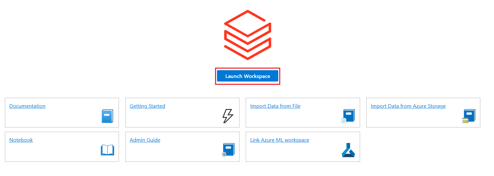

1. If prompted, select **Sign in with Microsoft Entra ID** and sign in with your lab credentials.

    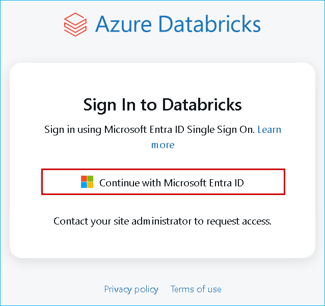

    > **Note:** Close any welcome or tour pop-ups that appear.

1. In the left navigation pane, select **Catalog**. Expand the **<inject key="Unity Catalog Name" enableCopy="false"/>** catalog. It has three schemas:

    - **raw**: the **litwaredata** volume, which points at Litware's CSV files in ADLS Gen2
    - **medallion**: empty for now; your pipeline writes its tables here
    - **curated**: empty for now; you publish tables here for Fabric

1. Expand **raw**, expand **Volumes**, and select **litwaredata**. These are the same eight CSV files that you referenced with a OneLake shortcut in Exercise 01. Unity Catalog governs them in place too.

1. In the left navigation pane, select **Workspace**, and then open **Shared** > **Analytics with ADB** > **01 DLT Notebook**. Read through the notebook. It defines:

    - **Bronze** tables that stream each raw CSV file in with Auto Loader
    - **Silver** tables that cast the columns and drop bad records with data quality expectations, such as `Churn IN ('Yes', 'No')`
    - **Gold** tables that aggregate churn and projected revenue by store contract, and revenue by product

    > **Note:** Don't run the notebook cells directly. The notebook is the source code for the pipeline that you create next.

## Task 2: Build a Delta Live Tables pipeline and publish curated tables

Delta Live Tables (DLT) lets you build reliable data pipelines declaratively. Azure Databricks manages the orchestration, data quality checks, and lineage. In this task, you turn the notebook into a running pipeline.

1. In the left navigation pane, select **Jobs & Pipelines**.

1. Select **Create**, and then select **ETL pipeline**.

    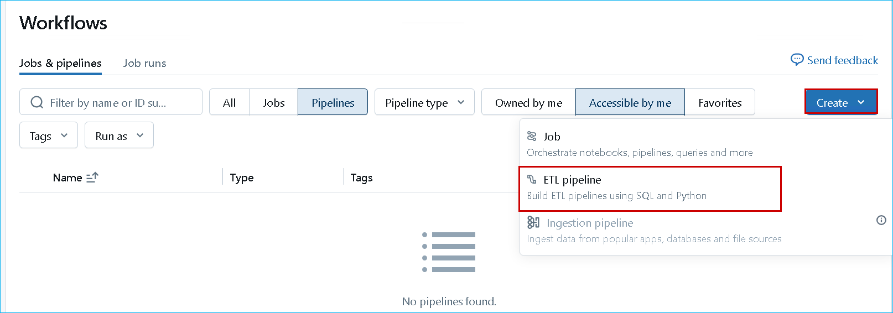

1. On the **Create pipeline** page, enter the following name:

    - **Pipeline name:** `DLT_Pipeline`

1. Under **Source code** (or **Paths**), select the folder icon, browse to **Shared** > **Analytics with ADB**, select **01 DLT Notebook**, and then select **Select**.

    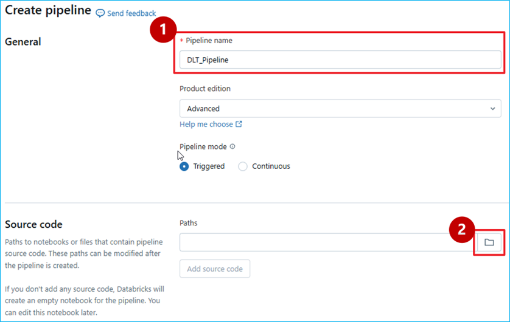

    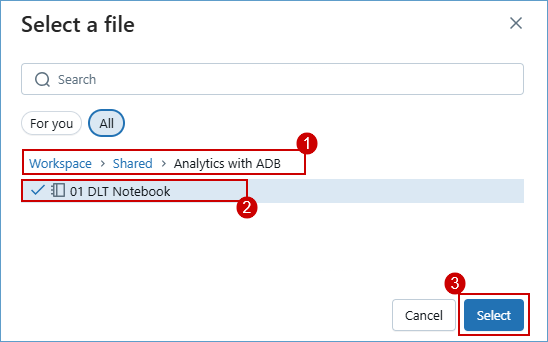

1. Under **Destination**, set the following values, leave everything else as the default, and then select **Create**:

    - **Catalog:** **<inject key="Unity Catalog Name" enableCopy="false"/>**
    - **Default schema:** `medallion`

    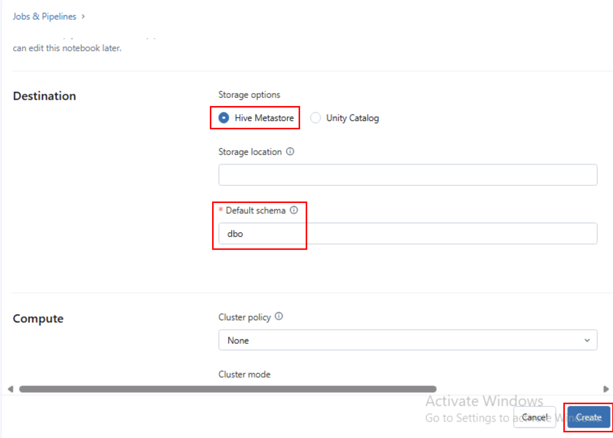

    > **Note:** The pipeline creation pages change often. If your page looks different, look for the pipeline name, the source code path, and the destination catalog and schema. Keep **Serverless** selected if it's offered.

1. Select **Start** to run the pipeline.

    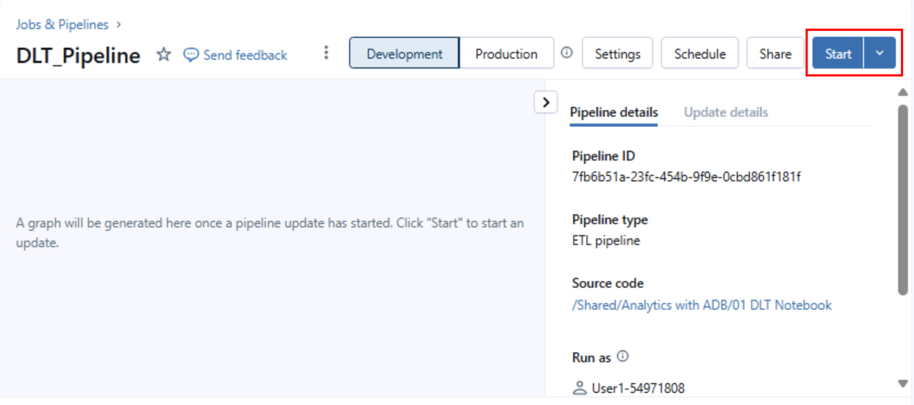

1. Wait for the update to finish, which takes about 3-5 minutes. The graph shows each table as it completes.

    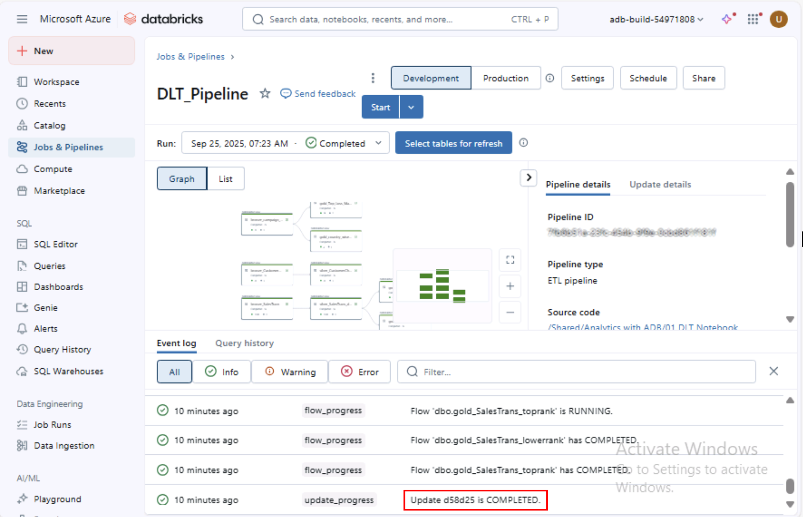

    The graph is the lineage of a **medallion architecture**: raw data lands in bronze, is cleaned in silver, and is aggregated into gold, ready for analytics and machine learning. Select a silver table to see how many records passed or failed each data quality expectation.

    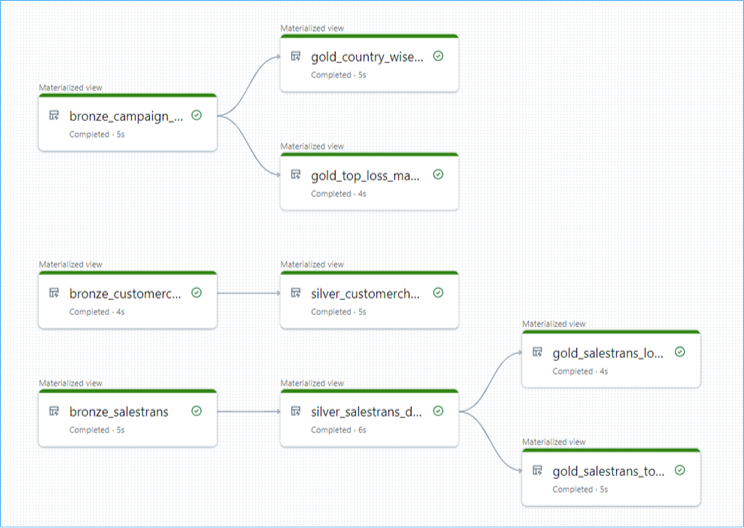

1. The pipeline creates streaming tables and materialized views, which Fabric mirroring can't read. Publish the gold results as regular Delta tables. In the left navigation pane, select **SQL Editor**, select a SQL warehouse from the compute dropdown (**Serverless Starter Warehouse** or **Zava SQL Warehouse**), paste the following SQL, and select **Run all**:

    ```sql
    CREATE OR REPLACE TABLE <inject key="Unity Catalog Name" enableCopy="false"/>.curated.churn_by_contract AS
    SELECT * FROM <inject key="Unity Catalog Name" enableCopy="false"/>.medallion.gold_churn_by_contract;

    CREATE OR REPLACE TABLE <inject key="Unity Catalog Name" enableCopy="false"/>.curated.sales_by_product AS
    SELECT * FROM <inject key="Unity Catalog Name" enableCopy="false"/>.medallion.gold_sales_by_product;
    ```

1. In **Catalog**, refresh the **curated** schema and confirm that it shows the **churn_by_contract** and **sales_by_product** tables.

    > **Congratulations** on completing the task! Now, it's time to validate it. Here are the steps:
    > - Hit the Validate button for the corresponding task.
    > - If you receive a success message, you can proceed to the next task.
    > - If not, carefully read the error message and retry the step, following the instructions in the lab guide.
    > - If you need any assistance, please contact us at cloudlabs-support@spektrasystems.com. We are available 24/7 to help you out.

    <validation step="00000000-0000-0000-0000-0000000000a5" />

## Task 3: Mirror the Azure Databricks catalog into Fabric

Mirroring an Azure Databricks catalog in Fabric creates shortcuts to the Unity Catalog tables, so changes in Databricks show up in Fabric without moving or replicating the data. In this task, you mirror Litware's catalog and query it with T-SQL.

1. Return to the **Microsoft Fabric** tab, select the **<inject key="Fabric Workspace Name" enableCopy="false"/>** workspace, and then select **+ New item**.

    

1. In the **New item** pane, search for and select **Mirrored Azure Databricks catalog**.

    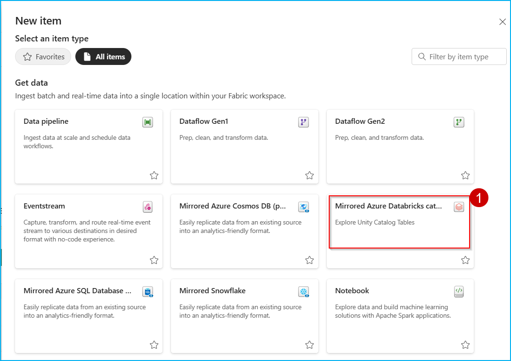

1. Select **New connection**, enter the following details, and then select **Connect**:

    - **URL:** <inject key="Databricks Workspace URL" enableCopy="true"/>
    - **Authentication kind:** **Organizational account**. Select **Sign in** and sign in with your lab credentials.

    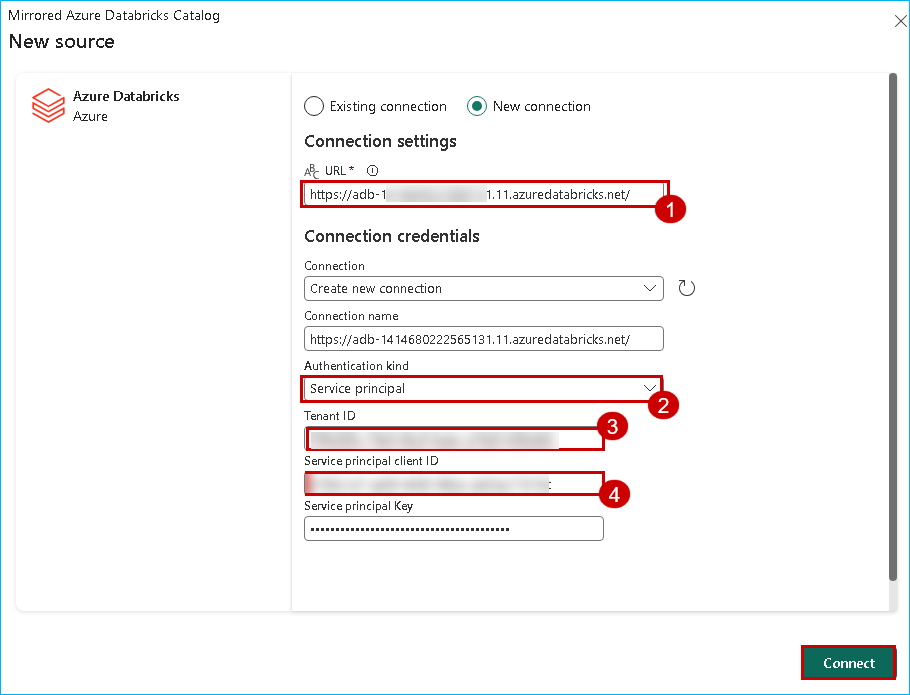

1. On the **Choose data** page, select **<inject key="Unity Catalog Name" enableCopy="false"/>** as the catalog. Select the **curated** schema and clear **medallion** and **raw**. Then select **Next**.

    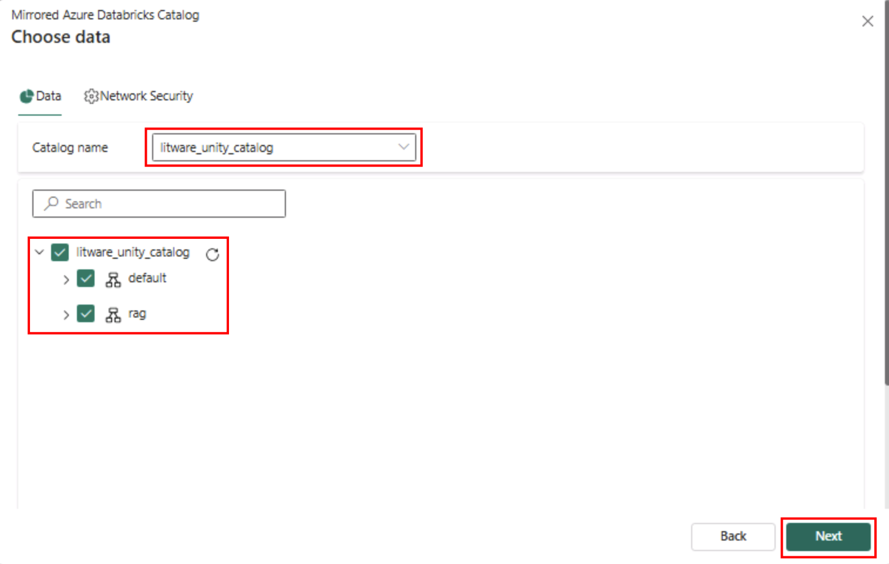

    > **Note:** Fabric mirroring skips streaming tables, materialized views, and views, which is why you published the gold results as tables in the **curated** schema.

1. On the **Review and create** page, keep the default name and select **Create**.

1. When the mirrored item opens, select **Monitor catalog** on the toolbar to track progress, and wait until the tables show as synced.

1. On the toolbar, select the dropdown to the left of **Share**, and then select **SQL analytics endpoint**. Select **Refresh**. In the **Explorer** pane, expand **Schemas** > **curated** > **Tables**.

    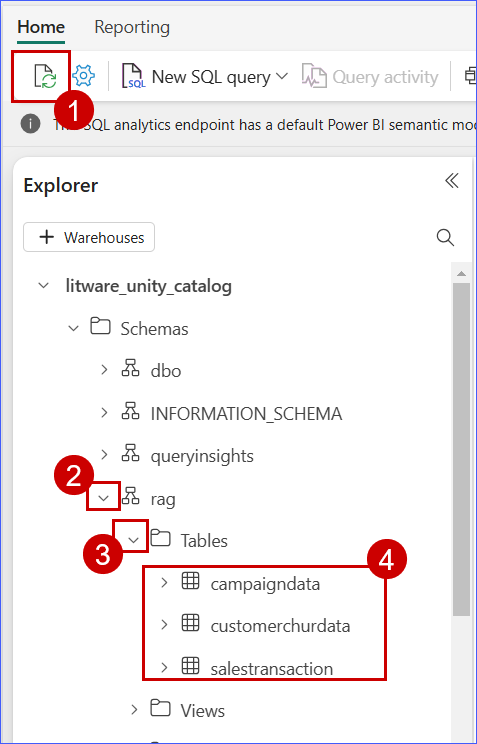

1. Select **New SQL query**, paste the following T-SQL, and then select **Run**:

    ```sql
    SELECT TOP 5 EnglishProductName, TotalRevenue, UnitsSold
    FROM curated.sales_by_product
    ORDER BY TotalRevenue DESC;

    SELECT StoreContract, Customers, ChurnRate, ProjectedLostRevenue
    FROM curated.churn_by_contract
    ORDER BY ProjectedLostRevenue DESC;
    ```

    Zava now queries Litware's Databricks-curated data with T-SQL in Fabric, and it was never copied. When Litware's pipeline refreshes the tables, Fabric sees the changes.

    > **Congratulations** on completing the task! Now, it's time to validate it. Here are the steps:
    > - Hit the Validate button for the corresponding task.
    > - If you receive a success message, you can proceed to the next task.
    > - If not, carefully read the error message and retry the step, following the instructions in the lab guide.
    > - If you need any assistance, please contact us at cloudlabs-support@spektrasystems.com. We are available 24/7 to help you out.

    <validation step="00000000-0000-0000-0000-0000000000a6" />

## 🧠 Quick check

<question source="./questions/question-04.md" />

## 🧾 Summary

In this exercise, you explored Litware's Unity Catalog, built a Delta Live Tables pipeline with bronze, silver, and gold layers and data quality expectations, and published its gold results as Delta tables. You then mirrored the catalog into Fabric and queried Litware's curated data with T-SQL, without copying it.

### Click on **Next** from the page navigation bar at the end of the lab guide page to proceed to the next page.

